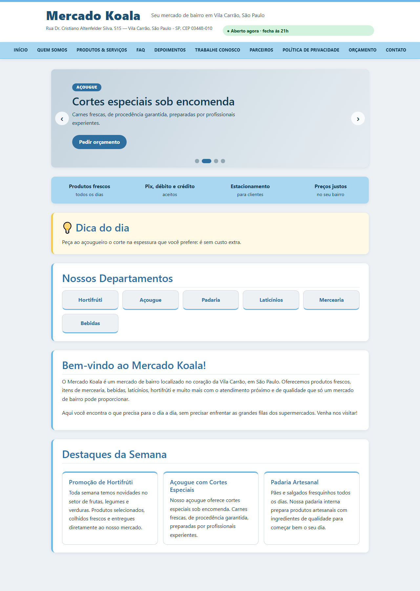
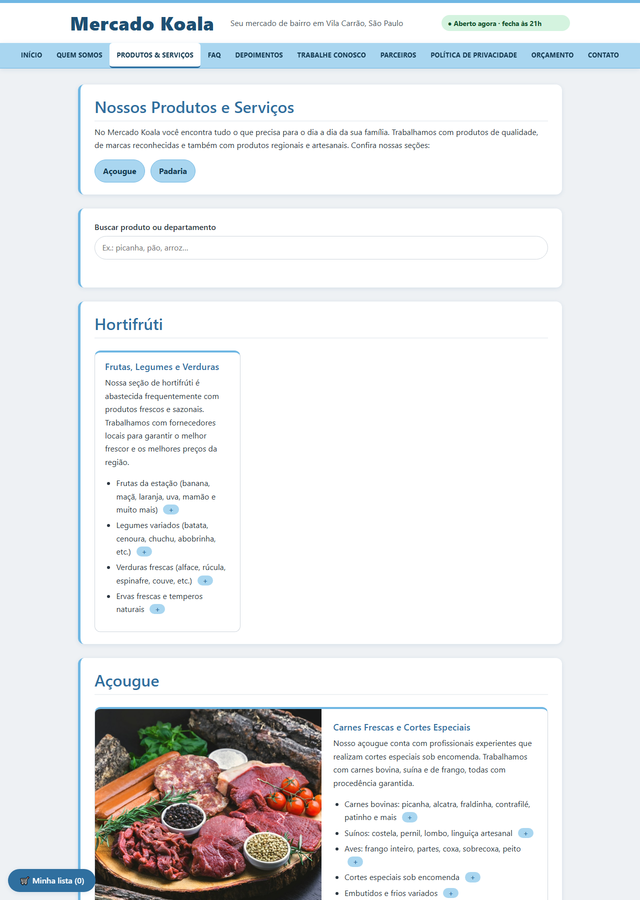
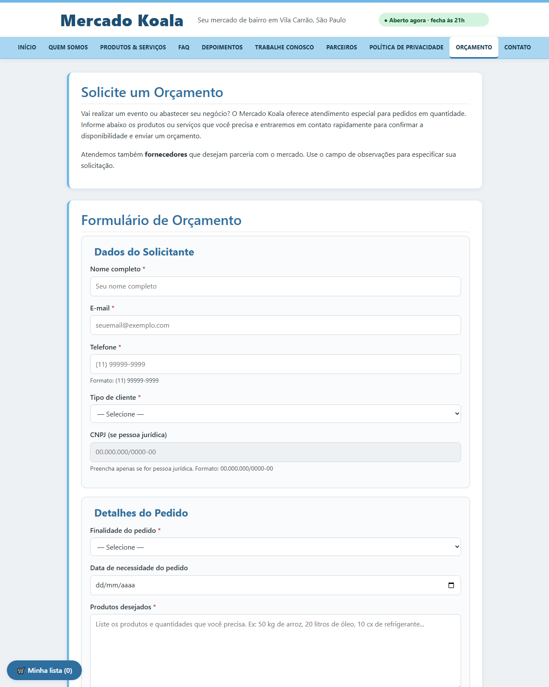
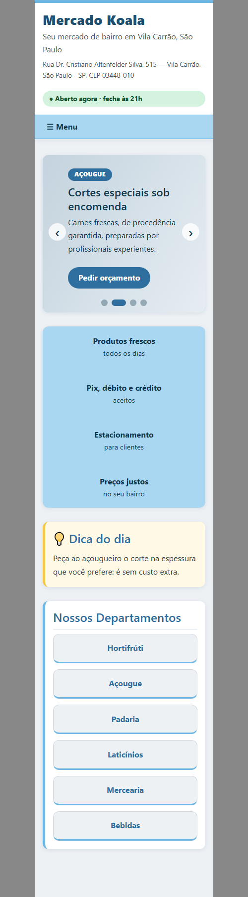

# Mercado Koala — Site de Divulgação

Site institucional desenvolvido como projeto escolar para a disciplina de **Desenvolvimento Frontend para Web** (A2 · 2026.2), sob orientação do Prof. Cid Andrade. A **Entrega 2** adiciona a identidade visual (CSS) ao site da Entrega 1.

---

## 👥 Integrantes do Grupo

| Nome | RGM |
|------|----|
| Veronica dos Santos Lima | 48489841|
| Vitor Arruda Dos Santos | 47351241 |
| Victor Correa | 47093102 |
| Felipe de Oliveira Brito | 47639890 |

---

## 🛒 SITE NOVO — Loja Koala (prints)

Fizemos um site novo em formato de **loja virtual**, na pasta [loja-koala/](loja-koala/), inspirado no layout do Supermercados Guanabara, com a marca Koala em **verde escuro**, bordas arredondadas e carrossel de destaques na página inicial.
Ele tem carrossel, lista de compras funcional, tema claro e escuro, página de catálogo de componentes (`tokens.css` e `AGENTS.md`) e **fotos reais**.
Explicação completa: [loja-koala/README.md](loja-koala/README.md).

**Como abrir:** baixe o projeto e abra `loja-koala/index.html` no navegador. Endereço hospedado (quando o GitHub Pages estiver ativo): https://veronisky.github.io/Koala-mercado-Javascript/loja-koala/

### 1. Página inicial (aba de produtos)
14 categorias com foto real, ofertas do dia com cronômetro, dicas, faixa da loja e rodapé "Baixe nosso aplicativo".


### 2. Produtos de uma categoria
Busca, filtro por categoria, ordenação e botão "Adicionar à lista".


### 3. Lista de compras
Adicionar itens, mudar a quantidade, marcar o que já pegou, ver o total e usar modelos (Dia-a-Dia, Churrasco, Festa). Fica salva no navegador.


### 4. Tema escuro
O botão "Tema escuro" troca as cores. O site lembra a escolha.


### 5. Catálogo de componentes
Botões, campos, cards e avisos em todos os estados (normal, hover, foco, desabilitado e erro), nos temas claro e escuro.


### 6. Versão para celular (360 px)
As categorias viram uma coluna e o menu vira um botão "Menu".


---

## 🏪 Introdução — A Organização

O **Mercado Koala** é um mercado de bairro localizado na:

> **Rua Dr. Cristiano Altenfelder Silva, 515 — Vila Carrão, São Paulo - SP, CEP 03448-010**

Trata-se de um negócio familiar, fundado com o objetivo de oferecer aos moradores da Vila Carrão produtos frescos, atendimento próximo e preços justos. O mercado conta com seções de hortifrúti, açougue, padaria artesanal, mercearia, bebidas, laticínios e produtos de limpeza e higiene.

O site foi desenvolvido para **divulgar o mercado digitalmente**, apresentando a história da empresa, seus produtos e serviços, canais de contato e formulários de orçamento — tudo com estrutura semântica em HTML5 puro, conforme os requisitos da Entrega 1.

---

## 🗂️ Estrutura do Projeto

```
Koala-Anuncio/
├── index.html               # Página Inicial
├── orcamento.html           # Página de Orçamento/Solicitação
├── paginas/
│   ├── contato.html         # Página de Contato (formulário)
│   ├── sobre.html           # Quem Somos
│   ├── produtos.html        # Produtos & Serviços
│   ├── faq.html             # Perguntas Frequentes
│   ├── depoimentos.html     # Depoimentos & Avaliações
│   ├── trabalhe-conosco.html # Trabalhe Conosco
│   ├── parceiros.html       # Parceiros & Marcas
│   └── politica.html        # Política de Privacidade
├── css/
│   ├── style.css            # Estilos do Mercado Koala (identidade visual)
│   └── bootstrap.min.css    # Bootstrap 5.3.3 (somente CSS, hospedado localmente)
├── js/
│   └── main.js              # Interatividade (JavaScript puro, sem bibliotecas)
├── assets/
│   ├── img/                 # Foto da entrevista com o responsável
│   ├── audio/               # Áudio de apresentação
│   └── video/               # Vídeo de apresentação
├── .gitignore               # Arquivos locais ignorados pelo Git
└── README.md
```

O workflow de publicação do GitHub Pages fica em `.github/workflows/` e não é
exibido nesta árvore resumida para manter a documentação mais limpa.

---

## 📸 Prints do site

Capturas reais do site rodando (versão para computador em 1280 px e versão para celular em 360 px).

### Página inicial
Cabeçalho com o selo "Aberto agora", menu de departamentos, carrossel de ofertas, faixa de benefícios, dica do dia e destaques da semana.



### Produtos & Serviços


### Orçamento (formulário com validação e máscaras)


### Versão para celular
O menu vira um botão "☰ Menu" e os blocos ficam em uma coluna.



---

## 🔗 Link do Site Hospedado

O site é publicado em: **https://veronisky.github.io/Koala-mercado-Javascript/**

O deploy está configurado para ocorrer automaticamente a cada atualização da branch `main`.
Para ativar pela primeira vez, acesse **Settings > Pages** no GitHub e selecione **GitHub Actions** como fonte de publicação.

---

## 🛠️ Desenvolvimento

### Contato com a Organização

O Mercado Koala é o negócio do pai de um dos integrantes do grupo (Marcelo Gabriel Alves),
o que garantiu acesso direto ao responsável para levantamento de informações reais sobre
endereço, funcionamento, serviços, produtos e diferenciais do estabelecimento.

A entrevista foi realizada de forma presencial, com visita ao mercado para coleta de informações.

> 📷 **Foto comprobatória do contato com o responsável:** disponível em `assets/img/entrevista-responsavel.jpg` e exibida na página `paginas/sobre.html`.


### Processo de Desenvolvimento

#### Decisões de Estrutura

- Optamos por 10 páginas interligadas conforme o requisito, com páginas adicionais de conteúdo relacionadas aos serviços reais do mercado.
- A estrutura de pastas separa as páginas de conteúdo (`/paginas/`) dos arquivos raiz (`index.html`, `contato.html`, `orcamento.html`), seguindo a sugestão do enunciado.
- Todos os caminhos relativos foram cuidadosamente ajustados para manter a navegação funcional entre as pastas.

#### Semântica HTML5

Todas as páginas utilizam as seguintes tags semânticas obrigatórias:
- `<header>` — cabeçalho do site com nome e descrição
- `<nav>` — menu de navegação principal (com `aria-label`)
- `<main>` — conteúdo principal da página
- `<section>` — seções temáticas com `aria-labelledby`
- `<article>` — artigos/blocos de conteúdo independentes
- `<footer>` — rodapé com copyright e links

#### Formulários com Validação HTML5 Nativa

Três páginas contêm formulários com validação nativa:
- **contato.html** — formulário de contato com `type="email"`, `type="tel"`, `pattern`, `required`, `minlength`, `maxlength`
- **orcamento.html** — formulário de orçamento com campos específicos para pessoa física/jurídica, `type="date"`, `type="tel"`, `pattern` para CNPJ
- **trabalhe-conosco.html** — formulário de cadastro de currículo com `type="number"` (idade com `min`/`max`)

#### Áudio e Vídeo

As tags `<audio>` e `<video>` estão incorporadas na página `paginas/produtos.html`, com arquivos placeholder em `assets/audio/` e `assets/video/`. O vídeo placeholder mostra um koala e ambos poderão ser reposicionados quando o CSS for implementado.

#### Desafios Técnicos

- **Caminhos relativos:** ajuste dos caminhos (`../`) para as páginas dentro da pasta `/paginas/` acessarem corretamente `index.html`, `contato.html` e `orcamento.html`.
- **Validação W3C:** atenção ao fechamento correto de todas as tags, uso adequado de `aria-label` e `aria-labelledby`, evitar elementos depreciados.
- **Acessibilidade:** uso de `<abbr>` para indicar campos obrigatórios, `aria-current="page"` no menu para indicar a página ativa.

---

## 🎨 Entrega 2 — Como o CSS foi feito

### Objetivo e inspiração

O visual foi inspirado na estrutura de um site de supermercado online (cabeçalho com marca à esquerda,
barra de departamentos, vitrines em cards e rodapé em colunas), mas **sem JavaScript e sem imagens**,
usando apenas HTML e CSS e a paleta do koala: **azul claro mesclado com cinza claro**.

### Passo a passo

1. **Análise do HTML existente.** As 10 páginas já eram semânticas (`header`, `nav`, `main`, `section`,
   `article`, `footer`). Por isso o CSS foi escrito sobre essas tags, sem espalhar classes no HTML.
2. **Paleta com variáveis CSS** (`:root` em `css/style.css`): azul claro `#a9d6f0`, azul médio `#6fb7e3`,
   azul escuro `#2f6f9f`, cinzas `#eef1f4`, `#cfd6dd` e `#4a5560`. Mudar uma cor muda o site inteiro.
3. **Bootstrap simples apenas no menu.** Foi usado só o **CSS** do Bootstrap 5.3.3 (arquivo local em
   `css/bootstrap.min.css`, sem CDN e sem o JavaScript do Bootstrap). O menu recebeu as classes
   `nav nav-pills justify-content-center`, `nav-item` e `nav-link`, e o `style.css` transforma essas
   "pílulas" em uma barra de departamentos azul clara com links em maiúsculas.
4. **Cabeçalho:** fundo branco, marca à esquerda, slogan e endereço ao lado e uma faixa azul no topo.
5. **Menu fixo (`position: sticky`)** com a página atual destacada via `aria-current="page"`
   (a mesma marcação de acessibilidade já existente).
6. **Seções e cards:** `section` virou cartão branco com borda azul lateral; seções com `article` viram
   uma vitrine em **CSS Grid** (`repeat(auto-fit, minmax(240px, 1fr))`) com efeito de elevação no `:hover`.
7. **Tabelas, formulários e botões:** cabeçalho de tabela azul, linhas zebradas, campos com foco azul
   (`:focus`), botões arredondados e botão "Limpar" em cinza.
8. **Rodapé com informações:** reorganizado em 3 colunas (Mercado Koala, Onde estamos, Links úteis) em
   todas as páginas, com degradê cinza para azul. No celular as colunas se empilham sozinhas.
9. **Página inicial:** foram adicionadas uma faixa de benefícios (produtos frescos, Pix/débito/crédito,
   estacionamento, preços justos) e a seção "Nossos Departamentos".
10. **Responsividade:** `meta viewport`, grids `auto-fit` e uma `@media (max-width: 576px)` que ajusta
    espaçamentos e desativa o menu fixo em telas pequenas.
11. **Correções de navegação:** os links do menu, do rodapé e dos textos foram ajustados para os caminhos
    corretos na raiz e em `paginas/` (`../` nas páginas internas). Foi conferido por script que todos os
    links locais apontam para arquivos existentes.
12. **Consistência de conteúdo:** o horário de segunda a sexta foi padronizado em 07h–21h
    (contato, FAQ e página inicial agora concordam).

### Técnicas de CSS utilizadas

Variáveis CSS, Flexbox (cabeçalho, corpo da página), CSS Grid (vitrines, rodapé, benefícios), `position: sticky`,
gradientes lineares, `:hover` / `:focus` / `:nth-child`, `:has()`, `clamp()`, transições e media queries.

### Limitações conhecidas

- O mapa da página inicial é um `iframe` do Google Maps e precisa de internet.
- O número de WhatsApp ainda não existe e aparece como "em breve".
- Os formulários não enviam dados a lugar nenhum (não há back-end).

---
assets/img/entrevista-responsavel.jpg e exibida na página paginas/sobre.html.

## ⚡ Entrega 3 — JavaScript e interatividade

Todo o JavaScript está em **um único arquivo**, [js/main.js](js/main.js), escrito em JavaScript puro (sem
jQuery, sem Bootstrap JS e sem bibliotecas). Ele é carregado com `<script src="js/main.js" defer>` no fim do
`<body>` de cada página. Cada recurso é uma função independente e só age se encontrar os elementos da página.

### Recursos

| Recurso | Onde | Como funciona |
|---|---|---|
| Menu "hambúrguer" | todas (celular) | cria o botão ☰, alterna a classe `aberto` e atualiza `aria-expanded` |
| Selo "Aberto agora / Fechado" | todas | compara `Date` com a tabela de horários, informa quando abre e atualiza a cada minuto |
| Voltar ao topo | todas | botão que aparece após 400 px de rolagem e usa `scrollTo({behavior: "smooth"})` |
| Animação ao rolar | todas | `IntersectionObserver` revela cada seção; respeita `prefers-reduced-motion` |
| Máscaras | formulários | telefone `(11) 99999-9999` e CNPJ `00.000.000/0000-00` enquanto digita |
| CNPJ condicional | orçamento | o campo só é habilitado (e obrigatório) quando o tipo é "Pessoa jurídica" |
| Contador de caracteres | formulários | mostra `n/máximo` e muda de cor perto do limite |
| Validação e envio simulado | formulários | `checkValidity()`, destaca campos inválidos, foca o primeiro erro e mostra mensagem de sucesso |
| Busca ao vivo | produtos e FAQ | filtra artigos e seções ignorando acentos e maiúsculas |
| FAQ sanfona | FAQ | clique ou Enter/Espaço abre e fecha a resposta (`role="button"`, `aria-expanded`) |
| Minha lista | produtos e orçamento | botão ＋ nos produtos, lista salva no `localStorage` e enviada ao campo "Produtos desejados" |
| Dica do dia | início | muda todo dia, a partir da data |
| Carrossel de ofertas | início | 4 slides de texto com troca automática (5 s), setas, bolinhas, teclado e toque; pausa ao passar o mouse |

### Decisões

- **Sem servidor:** os formulários não enviam dados de verdade. O `submit` é interceptado (`preventDefault`) e o
  envio é simulado com uma mensagem na tela.
- **Acessibilidade:** `aria-live`, `aria-expanded`, `role="status"/"alert"` e navegação por teclado nos recursos novos.
- **Segurança:** o texto dos produtos é inserido com `textContent`, nunca com `innerHTML`.
- **Robustez:** o `localStorage` é usado dentro de `try/catch` e, se estiver indisponível, o site continua funcionando.
- **HTML quase intocado:** só foi acrescentada a tag `<script>`. Os elementos novos são criados pelo JavaScript.
- **CSS:** os estilos dos recursos ficam no fim de [css/style.css](css/style.css).

### Testes feitos

Foi feito um teste simulado (jsdom) em 6 páginas, sem erros de execução, conferindo menu, selo de horário,
busca, FAQ, lista de compras, máscaras e validação. Falta apenas conferir o visual no navegador.

---

## 🛒 Loja Koala (site novo)

Os prints e a explicação do site novo estão no começo deste README e em [loja-koala/README.md](loja-koala/README.md).

---

## ✅ Checklist da Entrega 1

- [x] 10 páginas HTML interligadas (index, contato, orçamento + 7 de conteúdo)
- [x] Estrutura semântica HTML5 em todas as páginas (`header`, `nav`, `main`, `section`, `article`, `footer`)
- [x] Formulário de contato com validação/máscaras nativas do HTML5
- [x] Áudio e vídeo incorporados com placeholders em uma página do site
- [x] Código validado no W3C Validator
- [x] Repositório no GitHub, organizado em pastas
- [x] README e página "Quem Somos" com foto do contato com o entrevistado
- [x] Site hospedado e link disponível no README (GitHub Pages)
- [x] Organização real confirmada — Mercado Koala (será a mesma na Entrega 2)

---

## 📝 Conclusão

A Entrega 1 nos permitiu compreender na prática a importância da marcação semântica HTML5 para estruturar um site real. Trabalhar com uma organização conhecida facilitou o levantamento de informações e o planejamento das páginas.

O principal aprendizado foi perceber que uma boa estrutura HTML — mesmo sem nenhuma estilização — já organiza visualmente o conteúdo de forma compreensível, e que as escolhas semânticas impactam diretamente na acessibilidade e no SEO do site.

Os desafios envolveram principalmente o gerenciamento correto dos caminhos relativos entre arquivos em diferentes pastas e a atenção aos atributos de acessibilidade (`aria-*`). O grupo se organizou bem para dividir as páginas e manter um padrão consistente em todas elas.

Na Entrega 2 foi incorporado o CSS com a identidade visual do Koala (azul claro e cinza claro). Ainda falta substituir os arquivos placeholder de áudio e vídeo pelos reais.

---

*Projeto desenvolvido para fins acadêmicos — Disciplina de Desenvolvimento Frontend para Web, 2026.*
