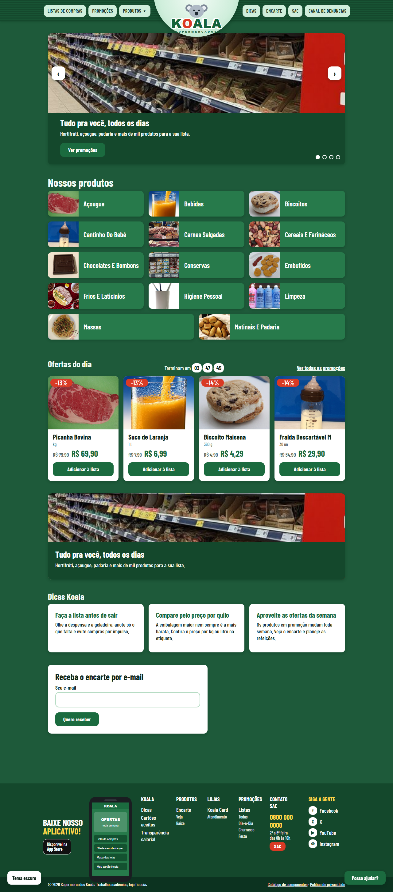
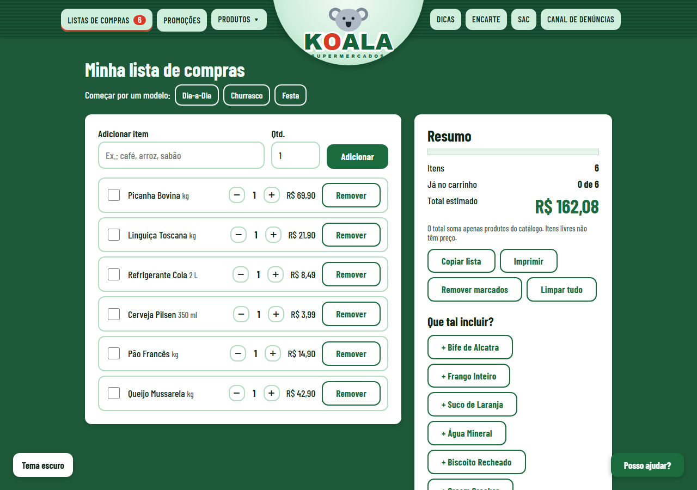
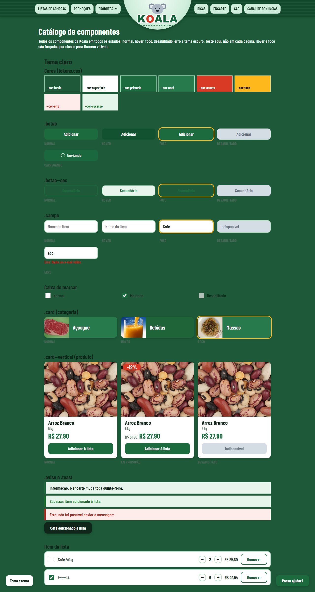
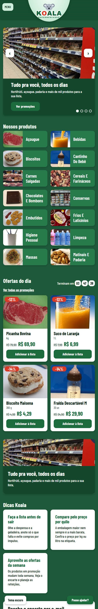
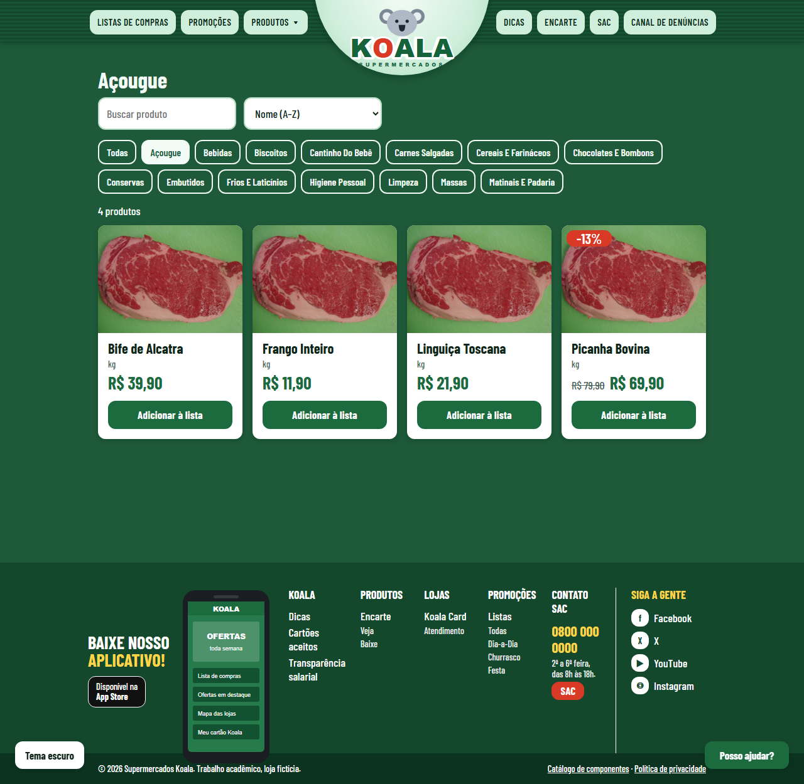
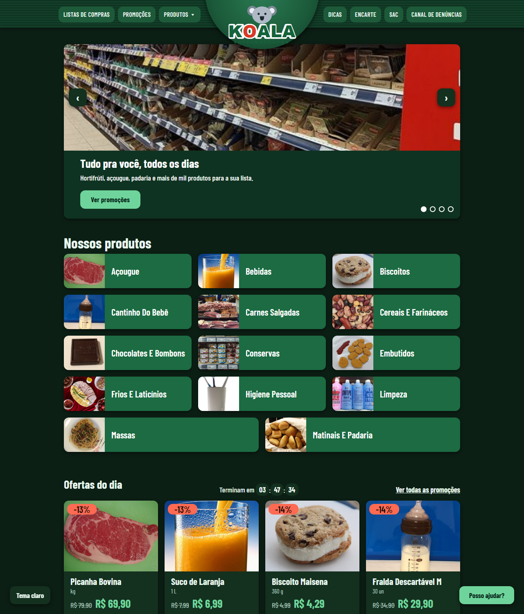

# Koala Supermercados

Trabalho de front-end: um site de supermercado fictício chamado **Koala**, feito com HTML, CSS e JavaScript puro, sem nenhuma biblioteca.

Usei como referência o site do Supermercados Guanabara (só o **layout**: a barra do topo, a grade de categorias, a lista de compras e o rodapé). A marca, o logo e as fotos são da Koala. A cor principal é o **verde escuro** (cor de mercado, passa confiança e frescor), com tema claro e escuro.

Repositório: https://github.com/veronisky/Koala-mercado-Javascript (este site fica na pasta `loja-koala/`)

## Integrantes do grupo

| Nome | RGM |
|------|----|
| Veronica dos Santos Lima | 48489841|
| Vitor Arruda Dos Santos | 47351241 |
| Victor Correa | 47093102 |
| Felipe de Oliveira Brito | 47639890 |

---

## Como ver o site

Não precisa instalar nada.

1. Baixe o projeto (`git clone https://github.com/veronisky/Koala-mercado-Javascript.git`) ou baixe o ZIP.
2. Entre na pasta `loja-koala/` e abra o arquivo `index.html` no navegador, com dois cliques.

---

## Ajustes da última revisão

- **Carrossel de destaques** na página inicial: 4 slides com foto real, troca automática a cada 5 s, setas, bolinhas, teclado (← →) e toque no celular. Pausa quando o mouse ou o foco está em cima e respeita `prefers-reduced-motion`.
- **Bordas arredondadas:** o raio passou de 2 px (quase reto) para **12 px** em `tokens.css` (`--raio`). Como botões, cards, campos, menu, etiquetas e carrossel usam `var(--raio)`, tudo que era quadrado ficou arredondado de uma vez.
- **Cor mais vendedora:** do azul-céu para **verde escuro** (sugestão recebida). Mudou só em `tokens.css` (claro e escuro) e nos SVGs do logo e do app. Os preços continuam em verde, as ofertas em vermelho e o foco do teclado em amarelo.
- **Publicação** na Vercel (projeto `koala-supermercados`).

## Prints

### 1. Página inicial (a aba de produtos)
A página principal tem as 14 categorias com foto real, as ofertas do dia com cronômetro, dicas, a faixa da loja e o rodapé com "Baixe nosso aplicativo".



### 2. Lista de compras
Aqui dá para adicionar itens, mudar a quantidade, marcar o que já pegou e ver o total. Tem modelos prontos (Dia-a-Dia, Churrasco e Festa). A lista fica salva no navegador, então não some se você recarregar a página. No print, usei o modelo Churrasco.



### 3. Catálogo de componentes
É a página que o professor pediu: mostra todos os componentes (botão, campo, card, aviso, item da lista) em todos os estados, ou seja, normal, hover, foco, desabilitado e erro. Ela aparece nos temas claro e escuro, um embaixo do outro. No print aparece só o tema claro.



### 4. No celular (360 px)
O site é responsivo. No celular as categorias viram uma coluna e o menu vira um botão "Menu".



### 5. Produtos de uma categoria


### 6. Tema escuro


---

## O que cada página faz

| Página | O que tem |
|---|---|
| `index.html` | Categorias com foto, ofertas do dia, dicas, newsletter com validação |
| `produtos.html` | Busca, filtro por categoria, ordenação por nome ou preço e botão para adicionar à lista |
| `promocoes.html` | O encarte, com os produtos em oferta ordenados por desconto |
| `lista.html` | Lista de compras completa (adicionar, quantidade, marcar, total, copiar, imprimir) |
| `sac.html` | SAC e Canal de denúncias, em abas, com validação dos campos |
| `catalogo.html` | Todos os componentes em todos os estados |

O botão **Tema escuro** no canto da tela troca entre claro e escuro. O site lembra sua escolha.

---

## Como o projeto está organizado

```
loja-koala/
├── tokens.css        <- todas as cores, espaços e raios (fonte única)
├── AGENTS.md         <- regras do projeto para a IA seguir
├── index.html
├── produtos.html
├── promocoes.html
├── lista.html
├── sac.html
├── catalogo.html
├── css/
│   └── estilos.css   <- estilo dos componentes e do layout
├── js/
│   ├── data.js       <- categorias, produtos, dicas e modelos de lista
│   └── app.js        <- tema, lista de compras, cabeçalho e rodapé
├── img/
│   ├── logo.svg      <- logo da Koala
│   ├── app.svg       <- celular do rodapé
│   └── fotos/        <- fotos reais + CREDITOS.md
└── docs/prints/      <- as imagens deste README
```

---

## O que o professor pediu (e como eu fiz)

O professor passou um fluxo em quatro passos: **referência antes, design system como contexto, prompt com critério de aceite, teste depois.**

1. **Referência antes:** olhei o site do Guanabara e copiei só o jeito de organizar a página.
2. **Design system como contexto:** criei o `tokens.css`, que é o único arquivo com cores. Todo o resto usa `var(--cor-...)`. Também criei o `AGENTS.md`, com as regras para a IA seguir.
3. **Prompt com critério de aceite:** a lista está logo abaixo.
4. **Teste depois:** a página `catalogo.html` serve para testar os componentes num lugar só, em vez de testar em cada página.

### Mude a geometria, não só a cor
Para o site não ficar com cara de template, mudei também a forma das coisas, não só as cores:
- **Raio:** quase reto, de 2 px, e não bem arredondado.
- **Espaço:** escala de 4 px (4, 8, 12, 16, 24, 40, 64).
- **Letras:** escala tipográfica de 1.25, com a fonte Barlow Condensed.

### Regras do `AGENTS.md`
- HTML semântico, com um único `<h1>` por página.
- Cores, espaços e raios só com `var(--...)` do `tokens.css`.
- Nunca usar cor hexadecimal fora do `tokens.css`.
- Reusar `.botao`, `.card` e `.campo`, sem criar variações.
- Sem bibliotecas novas.
- Testar em 360 px, 768 px e 1280 px.

---

## Critérios de aceite

- [x] A página inicial mostra as 14 categorias com foto, e cada uma leva ao filtro certo.
- [x] Adicionar um produto atualiza o contador da lista sem recarregar a página.
- [x] A lista continua salva depois de recarregar e calcula o total.
- [x] Os formulários mostram o erro de cada campo e levam o foco para o primeiro erro.
- [x] Dá para usar tudo pelo teclado, com foco visível.
- [x] Existe tema escuro, e o site lembra a escolha.
- [x] Não há cor hexadecimal fora do `tokens.css`.
- [x] O layout funciona em 360 px, 768 px e 1280 px. Conferi com prints em 1280 px e 360 px. O 768 px ainda precisa de uma conferida.

---

## Fotos e créditos

As fotos são reais e vieram do Wikimedia Commons. Cada foto tem sua licença, e a lista com autor e licença está em [img/fotos/CREDITOS.md](img/fotos/CREDITOS.md).

Cada categoria tem uma foto, e os produtos da mesma categoria usam a mesma foto. Os preços e produtos são inventados. O telefone 0800 do rodapé também é fictício.

---

## Tecnologias

- HTML5
- CSS3 (variáveis CSS, grid, flexbox)
- JavaScript puro (sem frameworks)
- `localStorage` para guardar a lista de compras e o tema

---

Feito pelo grupo (integrantes no começo deste arquivo) como trabalho da disciplina de Desenvolvimento Frontend para Web (Prof. Cid Andrade).
